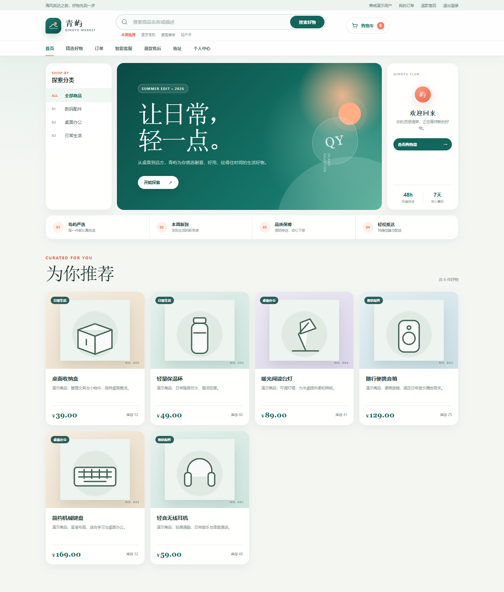
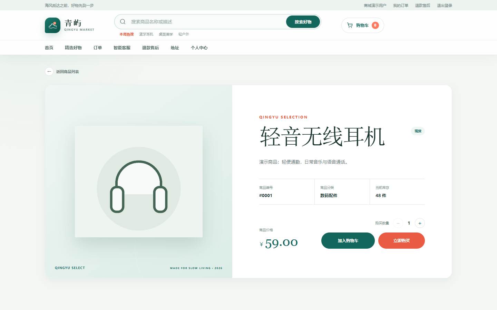
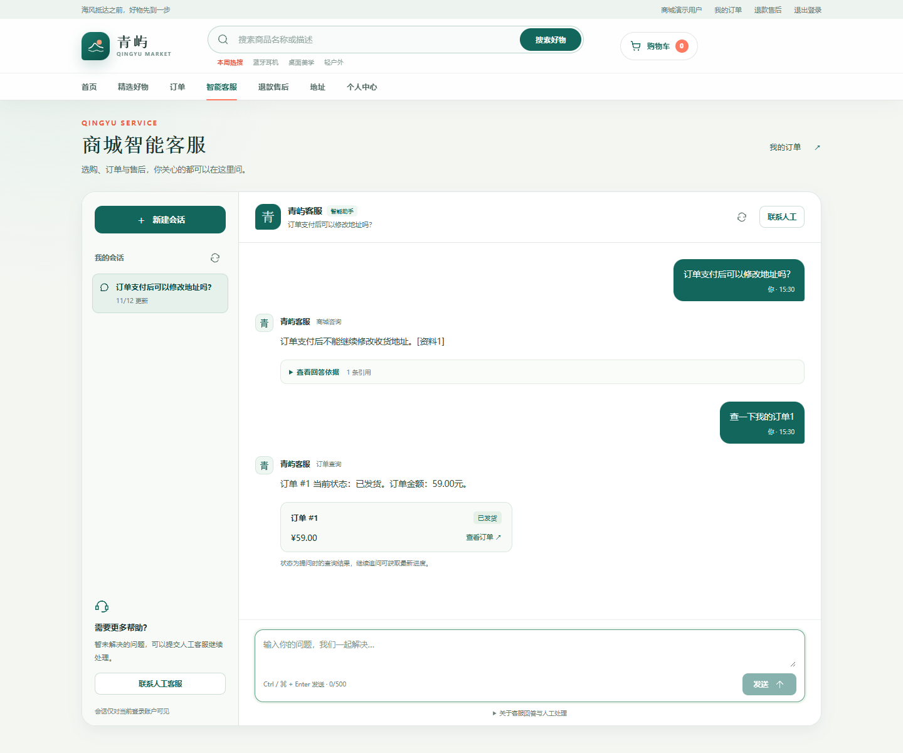
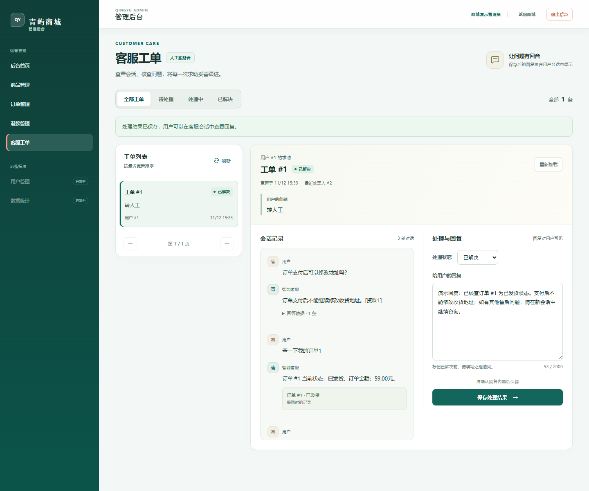
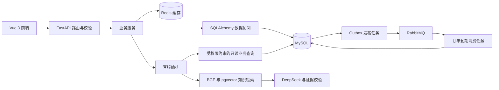

# 青屿商城 · Python 后端与 AI 应用实践

**展示版本**：[查看截图对应的源码分支](https://github.com/pan09033/qingyu-mall-backend/tree/showcase/portfolio-20261112)。本页更新界面截图和项目说明，默认分支中的应用代码保留原有版本。

一个使用 **Python / FastAPI** 开发的个人学习项目，围绕用户、商品、购物车、订单和售后实现商城流程，并扩展带资料引用、订单查询和人工工单的智能客服。

[本地演示与讲解路线](docs/SHOWCASE.md) · [Docker 部署](https://github.com/pan09033/qingyu-mall-backend/blob/showcase/portfolio-20261112/DEPLOYMENT.md) · [客服功能与边界](https://github.com/pan09033/qingyu-mall-backend/blob/showcase/portfolio-20261112/docs/customer-support.md)


## 这个项目能做什么

- **商城业务**：从商品浏览、购物车到订单、支付记录与售后，练习完整的业务状态流转。
- **后端实现**：接口分层、JWT 与角色权限、事务和库存锁、幂等请求、Redis 缓存、Outbox 与 RabbitMQ。
- **AI 应用**：检索商城规则并检查引用，按登录身份查询订单；资料不足时转人工工单继续处理。

这是个人学习项目。下方截图便于快速了解效果，功能表提供对应代码入口；支付采用开发环境模拟方式，尚未接入真实支付渠道。

## 界面预览

下面是 2026-11-12 从实际 Vue 页面截取的界面。点击图片可放大查看。

| 商品首页与分类 | 商品详情与购买入口 |
| --- | --- |
| [](docs/images/storefront.png) | [](docs/images/product-detail.png) |
| 分类导航、搜索入口、商品价格与库存展示。 | 查看商品资料、选择数量，进入购物车或结算流程。 |

| 客服规则问答与本人订单查询 | 管理端人工工单 |
| --- | --- |
| [](docs/images/customer-support.png) | [](docs/images/admin-support.png) |
| 规则回答显示资料编号，订单回答展示本人订单状态和详情入口。 | 查看会话记录、回复用户、更新处理状态；用户可刷新查看结果。 |

**截图环境**：虚构账号和商品，内存 SQLite；商品封面为 SVG 示意图。知识回答为固定演示结果，订单查询、会话和工单使用真实应用接口。这些截图展示交互流程，不是大模型效果评测或真实支付记录。

## 已实现的内容

| 模块 | 当前实现 | 代码入口 |
| --- | --- | --- |
| 用户与权限 | 注册登录、JWT 身份认证、用户与管理端角色权限 | [auth.py](https://github.com/pan09033/qingyu-mall-backend/blob/showcase/portfolio-20261112/app/services/auth.py) |
| 商品与购物车 | 商品分类、搜索、购物车、Redis 商品详情缓存、MinIO 图片存储 | [product.py](https://github.com/pan09033/qingyu-mall-backend/blob/showcase/portfolio-20261112/app/services/product.py) |
| 订单 | 库存扣减、数据库事务、行锁、幂等提交、取消及库存回补 | [order.py](https://github.com/pan09033/qingyu-mall-backend/blob/showcase/portfolio-20261112/app/services/order.py) |
| 异步消息 | Outbox 事件记录、RabbitMQ 投递与订单到期消费 | [app/mq](https://github.com/pan09033/qingyu-mall-backend/blob/showcase/portfolio-20261112/app/mq) |
| 支付与售后 | 支付记录、开发环境模拟支付、退款申请与管理端处理 | [payment.py](https://github.com/pan09033/qingyu-mall-backend/blob/showcase/portfolio-20261112/app/services/payment.py) |
| 智能客服 | BGE / pgvector 检索、DeepSeek 回答、引用校验、本人订单查询、有限上下文与人工工单 | [support.py](https://github.com/pan09033/qingyu-mall-backend/blob/showcase/portfolio-20261112/app/services/support.py) |

项目包含数据库迁移、自动化测试和 Docker Compose 配置。支付功能用于学习业务状态流转，尚未对接真实支付渠道；项目没有生产规模或商业收益声明。

## 技术结构



接口、参数校验、业务逻辑、数据访问和模型分别位于 `routers / schemas / services / repositories / models`。客服订单查询从当前登录用户取得身份；知识生成异常不会阻塞普通商品和订单接口。

## 本地演示

复现这些截图对应的版本，先克隆展示分支：

```powershell
git clone --branch showcase/portfolio-20261112 https://github.com/pan09033/qingyu-mall-backend.git fastApiProject
cd fastApiProject
```

准备 Python 3.12。只运行本仓库即可在 `http://127.0.0.1:8101/docs` 查看并调用演示 API。

配套 Vue 3 前端目前保存在私有仓库，本页截图可公开浏览。以下前后端联合演示步骤适用于已有前端源码的环境，需要 Node.js 22.12+；将两个项目放在同级目录：

```text
projects/
├── fastApiProject/     # 本仓库
└── mall-frontend/      # 配套前端
```

后端目录中安装依赖，启动隔离演示：

```powershell
python -m venv .venv
.\.venv\Scripts\Activate.ps1
python -m pip install -r requirements.txt
python -m tests.manual.showcase_preview
```

另开终端，在前端目录执行：

```powershell
npm ci
$env:VITE_API_BASE_URL = "http://127.0.0.1:8101"
npm run dev -- --host 127.0.0.1 --port 5174 --strictPort
```

打开 `http://127.0.0.1:5174`。用户账号 `support_demo`，管理员账号 `support_admin`，演示密码均为 `DemoOnly123!`。管理员入口为 `/admin/login`。这些账号仅存在于本地演示进程。

演示使用内存 SQLite，重启后恢复初始数据；不读取开发者 `.env`，不连接真实数据库、Redis、RabbitMQ、MinIO 或大模型 API。完整组件的行为需在完整运行环境中验证，详见[演示说明](docs/SHOWCASE.md)。

## 完整环境运行

将 `.env.example` 复制为 `.env` 并填写自己的配置。完整环境需要 MySQL、Redis、RabbitMQ、MinIO；真实知识问答还需要 PostgreSQL 的 `vector` 扩展、本地 BGE 模型以及 DeepSeek API 配置。

```powershell
Copy-Item .env.example .env
python -m alembic upgrade head
python -m alembic -c alembic-rag.ini upgrade head
python -m uvicorn app.main:app --reload
```

接口文档位于 `http://127.0.0.1:8000/docs`。订单到期、Outbox 与知识同步任务的启动配置见 [DEPLOYMENT.md](https://github.com/pan09033/qingyu-mall-backend/blob/showcase/portfolio-20261112/DEPLOYMENT.md)。模型调用可能产生服务商费用；本地演示不会调用它。

## 测试与阅读顺序

```powershell
python -m pytest -q
```

普通自动化测试使用内存 SQLite，模拟 Redis、向量库、消息队列和 AI 服务。端到端部署表现需要额外验证。

2026-11-12 发布版本验证：**413 项测试通过**，有 2 条依赖弃用提示；配套前端 `npm run build` 成功。浏览器操作验证了用户登录、商品展示、规则问答、本人订单查询、转人工及管理员回复。详见[本次验证记录](docs/verification-2026-11-12.md)。

建议从 [订单服务](https://github.com/pan09033/qingyu-mall-backend/blob/showcase/portfolio-20261112/app/services/order.py) 阅读事务与幂等处理，再看 [商品缓存](https://github.com/pan09033/qingyu-mall-backend/blob/showcase/portfolio-20261112/app/product_cache.py)、[消息任务](https://github.com/pan09033/qingyu-mall-backend/blob/showcase/portfolio-20261112/app/mq) 和 [客服编排](https://github.com/pan09033/qingyu-mall-backend/blob/showcase/portfolio-20261112/app/services/support.py)。客服历史评测口径记录在 [评测说明](https://github.com/pan09033/qingyu-mall-backend/blob/showcase/portfolio-20261112/docs/customer-support-evaluation-2026-09-28.md)，其中检索命中率和引用校验通过情况不等同于答案事实准确率。

## 目录

```text
app/             应用代码与 RAG 模块
migrations/      MySQL 迁移
rag_migrations/  PostgreSQL 向量库迁移
knowledge/       商城规则原文
scripts/         消息任务、同步与评测入口
tests/           自动化测试和隔离演示
docs/            展示截图、演示说明和功能文档
```

`practice/` 和历史学习笔记用于学习记录，运行入口位于 `app/`。请从 `.env.example` 配置自己的完整环境，或直接使用隔离演示。
