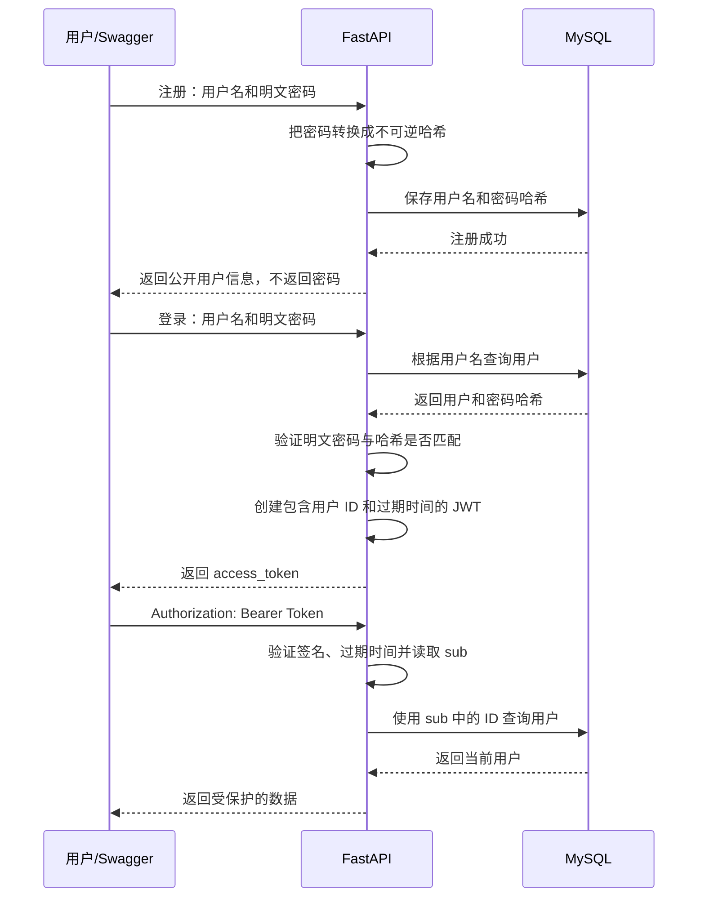

# FastAPI JWT 登录模块学习笔记

> 日期：2026-08-07  
> 对应项目：`D:\pythonstudy\fastApiProject`

## 一、先理解 JWT 是什么

JWT 的全称是 **JSON Web Token**，可以把它理解成服务器签发给用户的一张“临时电子通行证”。

用户第一次登录时需要提交用户名和密码。服务器验证成功后，不会要求用户以后的每次请求都重新发送密码，而是返回一个 Token。之后用户访问受保护接口时，只需要携带这个 Token。

简单比喻：

- 用户名和密码：办理通行证时出示的身份证明。
- JWT Token：办理成功后得到的临时通行证。
- 受保护接口：需要检查通行证才能进入的区域。
- Token 过期时间：通行证的有效期。
- JWT 密钥：服务器用来签发和验证通行证的秘密印章。

JWT 主要解决两个问题：

1. 服务器如何确认当前请求是哪个用户发出的。
2. 用户登录后，如何在一段时间内持续访问需要登录的接口。

## 二、JWT 的组成

一个 JWT 通常长这样：

```text
xxxxx.yyyyy.zzzzz
```

它由三部分组成，中间使用英文句点分隔：

```text
Header.Payload.Signature
```

### 1. Header：头部

记录 Token 使用的类型和签名算法，例如：

```json
{
  "typ": "JWT",
  "alg": "HS256"
}
```

### 2. Payload：载荷

保存 Token 中需要携带的信息。当前项目主要保存：

```json
{
  "sub": "21",
  "exp": 1786095000
}
```

- `sub`：subject，表示这个 Token 属于谁。当前项目保存用户 ID，并转换成字符串。
- `exp`：expiration time，表示 Token 的过期时间。

### 3. Signature：签名

服务器使用密钥对前两部分进行签名。以后收到 Token 时，服务器再次验证签名。如果有人擅自修改了 `sub`，签名校验就会失败。

### 特别注意：JWT 默认不是加密数据

Header 和 Payload 只是编码，不是加密。拿到 Token 的人通常可以解码并看到 Payload，所以绝对不能把密码、银行卡号等敏感信息放进 JWT。

签名的作用是防止内容被篡改，不是隐藏内容。

## 三、项目中的完整登录流程



最重要的主线只有一句话：

```text
注册保存密码哈希 → 登录验证密码 → 签发 Token → 请求携带 Token → 解析 Token 得到当前用户
```

## 四、JWT 模块中每个文件负责什么

| 文件 | 主要职责 |
|---|---|
| `app/config.py` | 读取 JWT 密钥、算法和过期时间 |
| `.env` | 保存不能直接写进代码的配置值 |
| `app/security.py` | 密码哈希、密码验证、创建 JWT |
| `app/schemas/auth.py` | 定义登录成功后的 Token 响应格式 |
| `app/schemas/user.py` | 定义注册请求、用户响应和修改资料模型 |
| `app/repositories/user.py` | 根据 ID 或用户名查询数据库 |
| `app/services/auth.py` | 处理注册和验证登录的业务逻辑 |
| `app/dependencies.py` | 从请求取出 Token，解析并返回当前用户 |
| `app/routers/auth.py` | 提供注册、登录、查询自己、修改自己的接口 |
| `app/routers/orders.py` | 使用当前登录用户限制订单访问范围 |

理解时不要把所有代码混在一起记。每个文件只负责流程中的一小步。

## 五、JWT 配置

`app/config.py` 中定义了：

```python
class Settings(BaseSettings):
    jwt_secret_key: str
    jwt_algorithm: str = "HS256"
    access_token_expire_minutes: int = 30
```

含义：

- `jwt_secret_key`：JWT 签名密钥，只能由服务器保存。
- `jwt_algorithm`：签名算法，当前使用 `HS256`。
- `access_token_expire_minutes`：Token 有效时间，当前是 30 分钟。

`.env` 中配置时应使用类似下面的写法：

```ini
JWT_SECRET_KEY=一段足够长且随机的秘密字符串
JWT_ALGORITHM=HS256
ACCESS_TOKEN_EXPIRE_MINUTES=30
```

不要把真实密钥放进学习笔记、响应结果或 Git 仓库。

## 六、注册为什么要先处理密码哈希

注册接口是：

```text
POST /auth/register
```

客户端提交：

```json
{
  "name": "小明",
  "age": 18,
  "username": "xiaoming",
  "password": "abc123456"
}
```

### 1. 请求模型接收明文密码

`UserRegister` 用来校验注册请求：

```python
class UserRegister(UserBase):
    username: str
    password: str
```

这里暂时接收明文密码是正常的，因为服务器必须拿到用户输入才能完成验证。但明文密码只能短暂存在于当前请求中，不能直接保存到数据库。

### 2. 把明文密码转换成密码哈希

`app/security.py`：

```python
password_hash = PasswordHash.recommended()


def hash_password(plain_password: str) -> str:
    return password_hash.hash(plain_password)
```

例如：

```text
明文密码：abc123456
密码哈希：$argon2id$...
```

密码哈希不是加密：

- 加密通常可以用密钥还原原文。
- 安全密码哈希是单向的，正常情况下不能还原原密码。
- 登录时不是“解密数据库密码”，而是使用哈希算法验证两者是否匹配。

### 3. 数据库只保存哈希

`app/services/auth.py` 中创建用户：

```python
new_user = User(
    name=user_data.name,
    age=user_data.age,
    username=user_data.username,
    hashed_password=hash_password(user_data.password),
)
```

数据库保存的是 `hashed_password`，不是 `password`。

### 4. 响应模型不能返回密码

注册接口使用：

```python
response_model=UserRegisterResponse
```

`UserRegisterResponse` 只有公开字段：

```python
class UserRegisterResponse(UserResponse):
    username: str
```

因此响应中不会出现 `password` 或 `hashed_password`。

记忆：**请求模型决定客户端可以提交什么，响应模型决定服务器允许返回什么。**

## 七、登录时发生了什么

登录接口是：

```text
POST /auth/login
```

### 1. 为什么登录不是普通 JSON 请求体

当前接口使用：

```python
form_data: Annotated[
    OAuth2PasswordRequestForm,
    Depends(),
]
```

`OAuth2PasswordRequestForm` 按 OAuth2 密码表单的格式读取 `username` 和 `password`，数据类型是表单，而不是 JSON。

在 Swagger 中点击登录接口后，会看到多个表单输入框。当前项目最重要的是：

- `username`
- `password`

### 2. 查询用户并验证密码

`authenticate_user()` 的主要流程：

```python
user = get_user_by_username(db, normalized_username)

password_is_valid = verify_password(
    password,
    user.hashed_password,
)
```

`verify_password()` 的作用：

```python
def verify_password(
    plain_password: str,
    hashed_password: str,
) -> bool:
    return password_hash.verify(
        plain_password,
        hashed_password,
    )
```

- 第一个参数是这次登录输入的明文密码。
- 第二个参数是数据库保存的密码哈希。
- 返回 `True` 表示匹配，返回 `False` 表示不匹配。

### 3. `DUMMY_HASH` 是什么

当用户名不存在时，项目仍然执行一次密码哈希验证：

```python
DUMMY_HASH = password_hash.hash(
    "dummy-password-for-timing-protection"
)
```

这样可以减小攻击者根据响应时间判断“用户名是否存在”的风险。它不是某个真实用户的密码。

### 4. 登录失败为什么返回 401

用户名不存在或密码错误时：

```python
raise HTTPException(
    status_code=status.HTTP_401_UNAUTHORIZED,
    detail="用户名或密码错误",
    headers={"WWW-Authenticate": "Bearer"},
)
```

统一返回“用户名或密码错误”，不要明确告诉外部到底是哪一个错误，这样更安全。

## 八、登录成功后如何生成 JWT

登录成功后执行：

```python
access_token = create_access_token(
    subject=str(user.id),
)
```

这里最容易混淆：`subject` 保存的是当前用户的数据库 ID，例如 `21`，只是按照 JWT 的常见写法转换成字符串 `"21"`。

`app/security.py` 中的核心代码：

```python
def create_access_token(subject: str) -> str:
    expire_time = (
        datetime.now(timezone.utc)
        + timedelta(
            minutes=settings.access_token_expire_minutes,
        )
    )

    payload = {
        "sub": subject,
        "exp": expire_time,
    }

    return jwt.encode(
        payload,
        settings.jwt_secret_key,
        algorithm=settings.jwt_algorithm,
    )
```

逐步解释：

1. `datetime.now(timezone.utc)`：取得当前 UTC 时间。
2. `timedelta(...)`：加上 Token 的有效分钟数。
3. `sub`：记录 Token 属于哪个用户。
4. `exp`：记录什么时候过期。
5. `jwt.encode(...)`：使用密钥和算法签名，生成最终 Token 字符串。

登录响应模型：

```python
class TokenResponse(BaseModel):
    access_token: str
    token_type: str
```

成功响应类似：

```json
{
  "access_token": "eyJ...",
  "token_type": "bearer"
}
```

## 九、请求如何携带 Token

客户端调用受保护接口时，需要添加 HTTP 请求头：

```text
Authorization: Bearer eyJ...
```

- `Authorization`：请求头名称。
- `Bearer`：认证方案，表示后面携带访问令牌。
- `eyJ...`：登录返回的 JWT。

`Bearer` 和 Token 之间必须有一个空格。

## 十、`OAuth2PasswordBearer` 到底做了什么

`app/dependencies.py`：

```python
oauth2_scheme = OAuth2PasswordBearer(
    tokenUrl="/auth/login",
)
```

它主要完成两件事：

1. 告诉 Swagger：获取 Token 的登录地址是 `/auth/login`。
2. 从请求头 `Authorization: Bearer ...` 中取出 Token 字符串。

特别注意：`OAuth2PasswordBearer` **不会验证 JWT 是否真实，也不会查询用户**。真正的 Token 验证由 `get_current_user()` 中的 `jwt.decode()` 完成。

如果请求没有携带 Bearer Token，`OAuth2PasswordBearer` 会直接返回：

```text
401 Not authenticated
```

## 十一、`get_current_user()` 如何得到当前用户

函数参数：

```python
def get_current_user(
    token: Annotated[str, Depends(oauth2_scheme)],
    db: Annotated[Session, Depends(get_db)],
) -> User:
```

FastAPI 会自动完成：

1. 执行 `oauth2_scheme`，从请求头获取 Token。
2. 执行 `get_db`，获得数据库会话。
3. 把结果分别传给 `token` 和 `db`。

解析 Token：

```python
payload = jwt.decode(
    token,
    settings.jwt_secret_key,
    algorithms=[settings.jwt_algorithm],
)
```

`jwt.decode()` 会验证：

- Token 格式是否正确。
- 签名是否由本项目的密钥生成。
- Token 是否已经过期。
- 算法是否在允许列表中。

读取用户 ID：

```python
subject = payload.get("sub")
user_id = int(subject)
```

为什么还要查数据库：

```python
user = get_user_by_id(db, user_id)
```

JWT 只告诉我们它签发时对应哪个用户。用户之后可能已经被删除，所以仍要查询数据库，确认这个用户当前确实存在，并获得最新的姓名、年龄等信息。

如果 Token 无效、过期、没有 `sub`、用户不存在，统一返回：

```text
401 无法验证登录凭证
```

## 十二、`CurrentUser` 为什么要创建

项目中写了：

```python
CurrentUser = Annotated[
    User,
    Depends(get_current_user),
]
```

它是一个可重复使用的类型别名，可以理解成：

```text
CurrentUser = 当前数据库中的 User 对象，但必须先通过 get_current_user 验证
```

于是接口中只需要写：

```python
def get_me(
    current_user: CurrentUser,
):
    return current_user
```

FastAPI 在调用 `get_me()` 前，会自动执行下面的依赖链：

```text
get_me
  └─ get_current_user
       ├─ oauth2_scheme：提取 Token
       └─ get_db：创建数据库会话
```

如果中间任意一步失败，接口函数就不会继续执行，而是直接返回错误响应。

## 十三、`GET /auth/me` 为什么不需要 user_id

接口代码：

```python
@router.get(
    "/me",
    response_model=UserRegisterResponse,
)
def get_me(
    current_user: CurrentUser,
):
    return current_user
```

`me` 表示“我自己”。当前用户已经从 Token 中得到，所以路径不需要再写：

```text
/auth/me/{user_id}
```

如果让客户端传 `user_id`，客户端可能把它改成其他人的 ID。使用 Token 中经过签名保护的用户 ID 更安全。

## 十四、`PATCH /auth/me` 如何修改自己的资料

当前项目已经实现：

```python
@router.patch(
    "/me",
    response_model=UserRegisterResponse,
)
def update_me(
    user_data: UserUpdate,
    current_user: CurrentUser,
    db: Database,
):
    update_data = user_data.model_dump(
        exclude_unset=True,
    )

    for field_name, new_value in update_data.items():
        setattr(
            current_user,
            field_name,
            new_value,
        )

    db.commit()
    db.refresh(current_user)
    return current_user
```

### `exclude_unset=True`

如果客户端只提交：

```json
{
  "age": 25
}
```

那么 `update_data` 只有：

```python
{"age": 25}
```

姓名不会被修改。这正是 PATCH 的部分更新语义。

### `setattr()`

下面两种写法作用相近：

```python
current_user.age = 25
```

```python
setattr(current_user, "age", 25)
```

循环更新字段时，字段名称保存在变量里，因此使用 `setattr()` 更方便。

## 十五、身份认证和权限控制不是一回事

### 身份认证 Authentication

回答：**你是谁？**

项目中由下面的流程完成：

```text
Bearer Token → get_current_user() → current_user
```

### 权限控制 Authorization

回答：**你能操作哪些数据？**

例如用户 A 已经成功登录，但他仍然不能查看、修改或删除用户 B 的订单。

订单查询条件同时使用订单 ID 和当前用户 ID：

```python
statement = select(Order).where(
    Order.id == order_id,
    Order.user_id == user_id,
)
```

而订单路由传入的是：

```python
current_user.id
```

所以查询含义是：

```text
找到编号为 order_id，并且属于当前登录用户的订单
```

这就是为什么订单接口使用：

```text
GET /orders/{order_id}
```

而不是让客户端提交：

```text
GET /users/{user_id}/orders/{order_id}
```

用户身份应该由 Token 决定，不能相信客户端随意提交的 `user_id`。

## 十六、Swagger 中的完整测试顺序

启动项目：

```powershell
cd D:\pythonstudy\fastApiProject
C:\Users\acerpbd\miniconda3\python.exe -m uvicorn app.main:app --reload
```

打开：

```text
http://127.0.0.1:8000/docs
```

### 第一步：注册

调用：

```text
POST /auth/register
```

请求体：

```json
{
  "name": "JWT测试用户",
  "age": 20,
  "username": "jwt_test_user",
  "password": "abc123456"
}
```

预期状态码：`201`。

### 第二步：在 Authorize 中登录

点击 Swagger 页面右上角的 **Authorize**，填写：

```text
username: jwt_test_user
password: abc123456
```

登录成功后，Swagger 会保存 Token，并自动在后续受保护请求中添加：

```text
Authorization: Bearer Token
```

注意：手动执行一次 `POST /auth/login` 只能看到 Token 响应，不代表 Swagger 已自动进入授权状态。要让 Swagger 后续接口自动携带 Token，应使用右上角的 **Authorize**。

### 第三步：查询自己

调用：

```text
GET /auth/me
```

预期状态码：`200`，返回当前登录用户，而不是其他用户。

### 第四步：修改自己

调用：

```text
PATCH /auth/me
```

只修改年龄：

```json
{
  "age": 25
}
```

预期状态码：`200`，年龄更新，姓名不变。

### 第五步：测试订单权限

创建当前用户的订单：

```text
POST /orders/
```

```json
{
  "product_name": "机械键盘",
  "quantity": 2
}
```

请求体中不需要 `user_id`，因为服务器使用 `current_user.id`。

## 十七、常见错误和判断方法

### 1. `401 Not authenticated`

响应：

```json
{
  "detail": "Not authenticated"
}
```

通常表示请求根本没有携带 `Authorization: Bearer ...` 请求头。

处理方法：在 Swagger 右上角点击 **Authorize** 登录。

### 2. `401 无法验证登录凭证`

通常表示已经携带 Token，但存在以下问题之一：

- Token 格式错误。
- Token 被修改。
- Token 使用了错误密钥签名。
- Token 已经过期。
- `sub` 缺失或无法转换成用户 ID。
- Token 对应用户已经不存在。

处理方法：重新登录获取新 Token。

### 3. `401 用户名或密码错误`

表示登录阶段失败，用户名不存在或密码不匹配。

### 4. `422 Unprocessable Entity`

表示请求已经到达 FastAPI，但参数没有通过 Pydantic 校验，例如：

- 年龄小于 6。
- 用户名长度不足。
- 密码长度不足。
- PATCH 明确发送 `null`。
- 登录接口错误地发送了 JSON，而不是表单数据。

### 5. Swagger 找不到新接口

代码修改后，如果 Swagger 仍然只显示旧接口，通常是 Uvicorn 没有重新加载代码。

处理方法：

1. 在运行服务器的终端按 `Ctrl+C`。
2. 使用带 `--reload` 的命令重新启动。
3. 刷新 `/docs` 页面。

## 十八、常用状态码

| 状态码 | 含义 | 当前项目中的例子 |
|---|---|---|
| `200` | 请求成功 | 登录、查询自己、修改自己 |
| `201` | 创建成功 | 注册、创建订单 |
| `204` | 删除成功且没有响应体 | 删除订单 |
| `401` | 未认证或登录凭证无效 | 无 Token、假 Token、密码错误 |
| `404` | 数据不存在或不属于当前用户 | 查询别人的订单 |
| `409` | 数据冲突 | 注册重复用户名 |
| `422` | 请求参数校验失败 | 年龄、用户名、密码格式错误 |

## 十九、必须掌握和暂时只需理解的内容

### 必须掌握

- 注册时只保存密码哈希，不能保存明文密码。
- 登录成功后生成 Token。
- 后续请求使用 `Authorization: Bearer Token`。
- `sub` 用来标识 Token 属于哪个用户。
- `Depends(get_current_user)` 会验证 Token 并查询当前用户。
- `current_user.id` 比客户端传入的 `user_id` 更可信。
- 身份认证和权限控制是两个不同概念。
- 响应模型绝不能返回密码或密码哈希。

### 现阶段理解即可

- JWT 三部分具体的 Base64URL 编码细节。
- HS256 内部签名计算过程。
- `DUMMY_HASH` 防止计时攻击的底层原理。
- OAuth2 完整规范和其他授权流程。
- Refresh Token、Token 黑名单和分布式密钥管理。

## 二十、自测题

### 题目

1. JWT 的三部分分别是什么？
2. JWT 的 Payload 默认是否保密？
3. 为什么不能把密码直接放进 JWT？
4. 注册时数据库应该保存明文密码还是密码哈希？
5. `OAuth2PasswordRequestForm` 接收 JSON 还是表单？
6. `OAuth2PasswordBearer` 会不会自动验证 JWT 签名？
7. 当前项目的 `sub` 保存了什么？
8. 为什么解析出 `sub` 后还要查询数据库？
9. `CurrentUser` 是一个新的数据库模型吗？
10. `GET /auth/me` 为什么不需要 `user_id`？
11. `401 Not authenticated` 通常说明什么？
12. 身份认证和权限控制分别解决什么问题？

### 答案

1. Header、Payload、Signature。
2. 不保密。Payload 通常可以被解码查看，只是签名可以防止篡改。
3. JWT 默认不是加密的，拿到 Token 的人可能看到 Payload。
4. 保存不可逆的密码哈希。
5. 表单数据。
6. 不会。它主要负责提取 Bearer Token；签名验证由 `jwt.decode()` 完成。
7. 当前登录用户的数据库 ID，并以字符串形式保存。
8. 用户可能已被删除，而且数据库中保存的是用户最新信息。
9. 不是。它是 `Annotated[User, Depends(get_current_user)]` 的类型别名。
10. 当前用户 ID 已经从经过签名验证的 Token 中取得。
11. 请求没有携带正确的 Bearer Token 请求头。
12. 身份认证回答“你是谁”，权限控制回答“你能操作哪些数据”。

## 二十一、最后用一句话串起全部代码

```text
用户注册时保存密码哈希；用户登录时验证密码并签发包含用户 ID 的 JWT；后续请求携带 JWT，FastAPI 依赖解析 Token、查询当前用户，再用当前用户 ID 限制他只能操作自己的数据。
```

